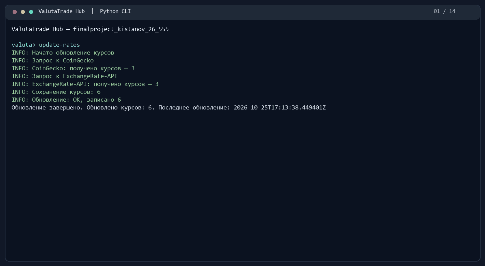

# finalproject_kistanov_26_555

ValutaTrade Hub — консольное приложение для виртуального валютного портфеля:
регистрация, вход, покупка и продажа валют, оценка портфеля и просмотр курсов.
Python 3.14, uv, PrettyTable, requests, Ruff; хранение данных в JSON.

## Установка и запуск

```powershell
git clone https://github.com/pakistanov/finalproject_kistanov_26_555.git
cd finalproject_kistanov_26_555
uv sync --locked
uv run finalproject_kistanov_26_555
```

Перед обновлением курсов скопируйте `.env.example` в `.env` в корне проекта
и заполните ключи [ExchangeRate-API](https://www.exchangerate-api.com/)
и [CoinGecko Demo](https://www.coingecko.com/en/developers/dashboard).
Файл читается автоматически; переменные окружения имеют приоритет.
`.env` не попадает в Git и сборку.

## Команды

В консоли приложения:

```text
update-rates
register --username alice --password 1234
login --username alice --password 1234
buy --currency BTC --amount 0.05
sell --currency BTC --amount 0.01
show-portfolio
show-portfolio --base EUR
get-rate --from USD --to BTC
show-rates --top 3
show-rates --currency RUB
show-rates --base EUR
currencies
logout
help
exit
```

Выбрана упрощённая модель из задания: `buy` увеличивает баланс валюты,
`sell` уменьшает его. USD используется для оценки, списания и зачисления USD
не выполняются. `amount` — количество валюты; новый портфель пуст.
Пароль — минимум 4 символа. Справка по аргументам: `buy --help`.

Сессия живёт до выхода из приложения. Повторный `login` заменяет пользователя;
неудачный вход сбрасывает сессию. Торговля и просмотр портфеля требуют входа.

`update-rates --source coingecko` и `update-rates --source exchangerate`
обновляют один источник. `show-rates --top N` выбирает N самых дорогих
криптовалют по цене в USD, затем переводит значения в указанную базу.

## Данные, кэш и Parser Service

В `data/`: `users.json` — пользователи с солью и хешем пароля,
`portfolios.json` — кошельки, `rates.json` — текущие курсы,
`exchange_rates.json` — история курсов. В репозитории файлы инициализированы пустыми.

Core использует локальный кэш. TTL по умолчанию — 300 секунд; при устаревании
`get-rate` и торговые команды предлагают выполнить `update-rates`.
`show-rates` показывает состояние свежести. При отказе одного API сохраняются
данные остальных и предыдущие пары; при отказе всех кэш не перезаписывается.

Настройки путей, TTL, базовой валюты, API и логов — в `[tool.valutatrade]`
файла `pyproject.toml`. Действия записываются в `logs/actions.log`, обновления —
в `logs/parser.log`; журналы JSON с ротацией. Во время `update-rates` краткий
ход обновления выводится также в консоль. `log_verbose = true` добавляет балансы
до и после сделки. Ключи API хранятся только в окружении или `.env`.

Периодическое обновление (остановка — Ctrl+C):

```powershell
uv run python -m valutatrade_hub.parser_service.scheduler --interval 300
```

## Структура

```text
valutatrade_hub/
├── core/            # models.py, currencies.py, exceptions.py, usecases.py, utils.py
├── infra/           # settings.py, database.py
├── parser_service/  # config.py, api_clients.py, updater.py, storage.py, scheduler.py
├── cli/             # interface.py
├── decorators.py
└── logging_config.py
data/                # четыре JSON-файла
demo/                # запись работы
main.py              # точка входа
pyproject.toml
uv.lock
Makefile
```

## Проверка и сборка

```powershell
uv run ruff check .
uv run ruff format --check .
uv build
```

Пакеты создаются в `dist/`. Установка wheel в отдельное окружение:

```powershell
uv venv .venv-install
uv pip install --python .venv-install dist/finalproject_kistanov_26_555-0.1.0-py3-none-any.whl
.venv-install/Scripts/finalproject_kistanov_26_555.exe
```

При установленном GNU Make доступны `make install`, `make run`, `make lint`,
`make format`, `make check`, `make build`, `make package-install`.
Разработка ведётся по Gitflow: `feature/*` → `develop` → `release/*` → `main`.

## Демонстрация

Полный цикл команд, обновление курсов и обработка ошибок:
[запись asciinema](demo/demo.cast) (`asciinema play demo/demo.cast`).


